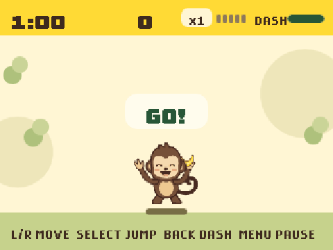
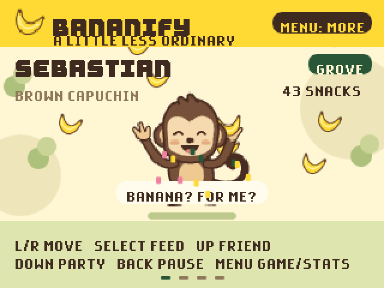
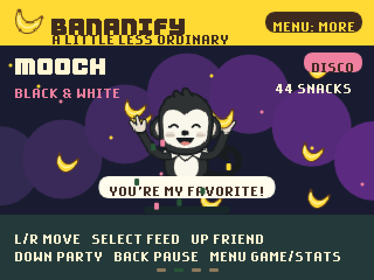
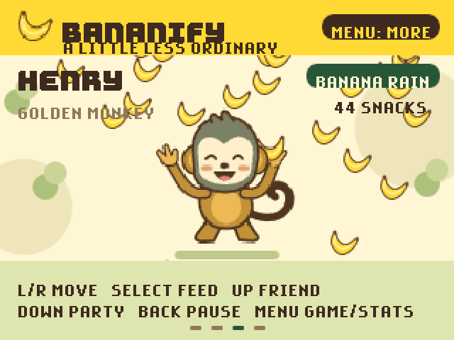
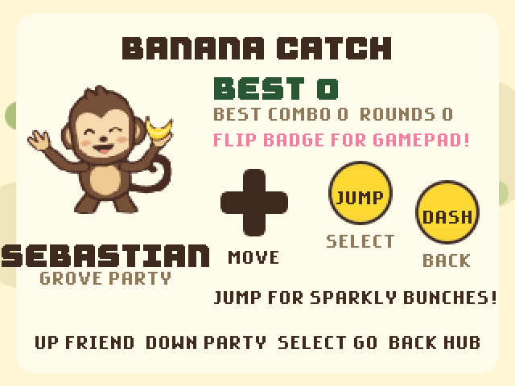
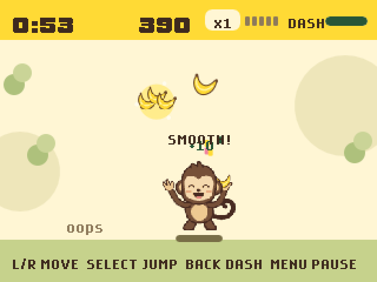
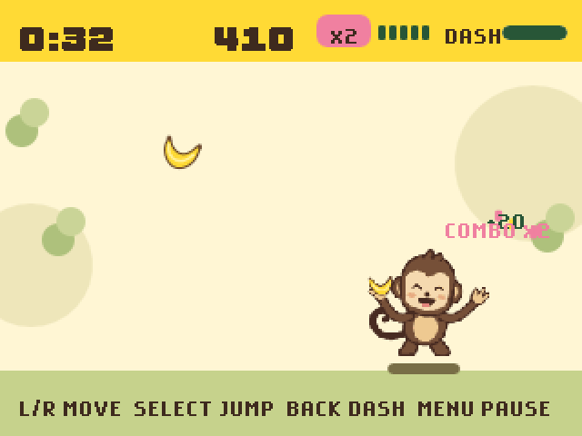
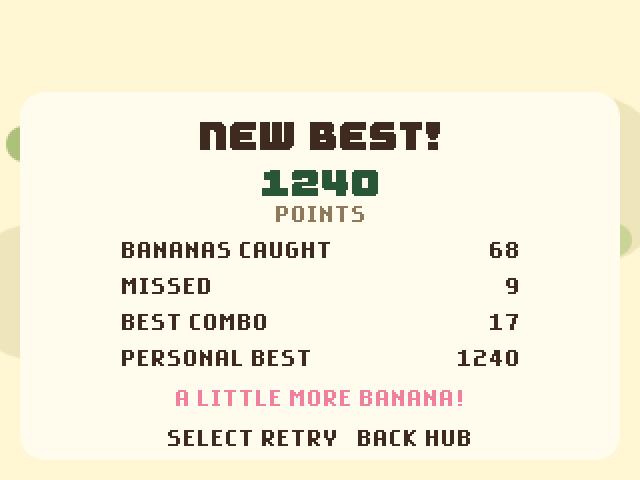
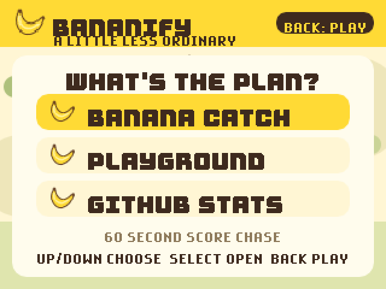
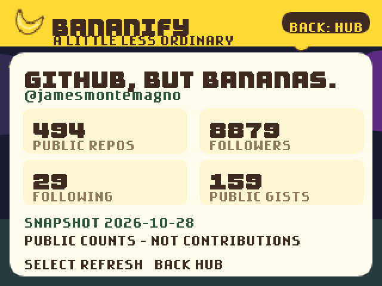

# Bananify for the GitHub Universe badge

Bananify on the GitHub Universe 2026 badge: a pocket banana party with three monkey friends, a Banana Catch mini-game, party themes, and your public GitHub stats.

<p align="center">
  
</p>

## Meet the monkeys

Feed them, move them around, and switch friends and party modes. Three snacks in a row earns a nap.

| Sebastian · Grove | Mooch · Disco | Henry · Banana Rain |
| --- | --- | --- |
|  |  |  |

## Banana Catch

A 60-second score chase built for holding the badge upside down like a gamepad. Run with the D-pad, **Select** to jump, **Back** to dash. Catch falling bananas for 10 points, jump for sparkly bonus bunches worth 30, and chain catches for up to a ×5 combo.

| Pick your monkey | Leap for the bonus bunch |
| --- | --- |
|  |  |
| **Party while you play** | **Chase a new best** |
|  |  |

## Hub and GitHub stats

**Menu** opens the hub. The stats screen shows public repositories, followers, following, and gists for `jamesmontemagno`, and refreshes over the badge's Wi-Fi.

| Hub | GitHub stats |
| --- | --- |
|  |  |

## Install on your badge

The app targets the **October 2026 GitHub Universe badge firmware** (MicroPython on RP2350B).

1. Put the badge into USB Disk Mode: open the **Mass Storage** app, or double-tap **RESET**. A drive named **BADGER** appears.
2. Copy the [`bananify`](bananify) folder to `BADGER/apps/bananify` (some firmware uses `BADGER/system/apps/`). Do not copy anything to the `RP2350` bootloader drive.
3. Eject BADGER. The badge restarts into its menu; open **Bananify**.

The menu icon is `bananify/icon.png`. Stock event firmware ignores app icons until its menu is patched; see the [badger/home USB serial guide](https://github.com/badger/home/blob/main/hardware/USB_SERIAL.md).

Everything except the stats refresh works offline. To show a different account, change `USERNAME` in [`bananify/profile.py`](bananify/profile.py) and replace `profile_seed.json`. Full controls, scoring, saved data, and network details are in the [app README](bananify/README.md).

## Development

The app uses the 2026 badge runtime globals (`badge`, `screen`, `image`, `shape`, …) and Badgeware `State`. Banana Catch's gameplay lives in a firmware-free model, [`catch_game.py`](bananify/catch_game.py), so it can be tested on a computer:

```sh
cd github-badger
python -m unittest discover -s tests -p test_bananify.py
```

Try it in the [badge simulator](https://badger.github.io/editor), then test on a real badge before calling a change done. Screenshots in this folder were captured from the simulator.
